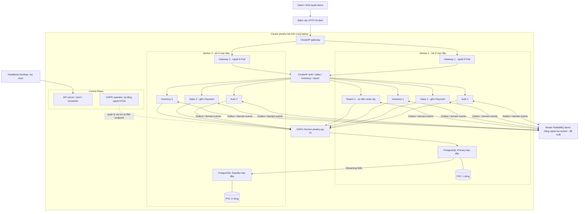

# Baseline Kubernetes chính thức — jewelry-lab

Ngày chốt: **13/11/2026**, múi giờ Asia/Saigon.

## 1. Quyết định đã được phê duyệt và phạm vi

Đây là baseline chính thức cho mọi giai đoạn Kubernetes tiếp theo, thay thế
các phương án thảo luận trước đây về 6/8 business Pod hoặc Report hai replica.
**Không tự đổi số replica, tách Payment thành service, giảm workload hoặc đổi
kiến trúc vì ước lượng tài nguyên.** Nếu thiếu tài nguyên, dừng, báo số đo và
xin phê duyệt phương án thay đổi trước khi tiếp tục.

Phiên chốt kiến trúc ban đầu chỉ tạo tài liệu này. Sau đó người dùng đã
phê duyệt triển khai Giai đoạn 3 ngày 13/11/2026. Kết quả thực tế hiện là
**PASS sau phiên tiếp tục Giai đoạn 3 với quy tắc tài nguyên mới đã phê duyệt**; xem
[báo cáo Giai đoạn 3](kubernetes-phase3-report.md). Không triển khai NestJS
hoặc Gateway; không tự chuyển Giai đoạn 4. Kiến trúc đích dưới đây giữ nguyên.

| Thành phần | Worker 1, bố trí ban đầu | Worker 2, bố trí ban đầu | Tổng |
|---|---|---|---:|
| Auth | 1 | 1 | 2 |
| Sales, gồm Payment | 1 | 1 | 2 |
| Inventory | 1 | 1 | 2 |
| Report | 1 | 0 | 1 |
| PostgreSQL | Primary | Standby | 2 |
| **Tổng trong baseline** | **5** | **4** | **9** |

9 Pod = **7 business Pod + 2 PostgreSQL Pod** ở trạng thái ổn định. Không bao
gồm Gateway, RabbitMQ, CNPG operator, system Pods, migration/bootstrap Jobs
hoặc Pod tạm trong rollout/recovery. Không hiểu đây là hard cap tổng Pod toàn
cluster. Không bật autoscaling làm thay đổi replica baseline nếu chưa duyệt.

Gateway ưu tiên **2 replica NestJS**, phân bố hai worker, tính ngoài 9 Pod.
Chưa chuyển sang Kong. Report chấp nhận availability thấp hơn ba service chính.

Primary/Standby là vai trò thay đổi được, không phải tên node cố định. Bảng là
trạng thái ban đầu mong muốn cho buổi demo; sau failover, Worker 2 có thể chứa
primary. Không pin vĩnh viễn primary vào Worker 1. Nếu bootstrap chọn vai trò
ngược bảng, ghi nhận hoặc làm planned switchover theo quy trình được duyệt;
không sửa Pod thủ công để ép vai trò.

## 2. Nền tảng và bằng chứng đã có

- Cluster: `jewelry-lab`, kind **0.33.0**, Kubernetes **1.36.1**.
- Một control plane, hai worker trên cùng Docker Desktop/WSL2/laptop.
- Kubeconfig riêng: `/home/hung/.kube/jewelry-lab.config`, context
  `kind-jewelry-lab`; không commit/in nội dung kubeconfig.
- Node image đã pin:
  `kindest/node:v1.36.1@sha256:3489c7674813ba5d8b1a9977baea8a6e553784dab7b84759d1014dbd78f7ebd5`.
- Host: Windows 10, Ubuntu 26.04.1/WSL2, RAM vật lý 16 GB, i5-7200U hai core,
  bốn logical CPU; Linux nhìn thấy khoảng 7,7 GiB RAM và 2 GiB swap.

### Trạng thái triển khai

| Giai đoạn | Kết quả và giới hạn |
|---|---|
| 1 — Cluster nền | PASS: 3 node Ready, 13 system Pods; chưa có business workload |
| 2 — Network | PASS: hai BusyBox Pod khác worker gọi HTTP Pod IP hai chiều; DNS Service, ClusterIP và đổi backend qua worker khác đều PASS |
| 2 — Cleanup | Namespace `jewelry-test`, hai Pod và Service đã xóa; giữ cluster, images/volumes và Compose |
| 3 — Hạ tầng dữ liệu | **PASS**: CNPG1.30.1 trên CP, PostgreSQL16.15 Primary/Standby Ready khác Worker/PVC, streaming async, 4 DB/schema và roles riêng |
| 3 — Dependencies/config/migrations | **PASS**: RabbitMQ demo riêng ngoài Worker, Pod AMQP probe PASS/cleanup; Secrets/ConfigMaps/JWT mới; 4 migration Jobs Completed, tổng39 migrations checksum khớp source |
| 4 trở đi | **Chưa triển khai**; đủ headroom để cân nhắc Auth2 tuần tự/giám sát; cần kiểm tra runtime image và cấu hình/fixture Auth theo phạm vi giai đoạn mới |

Nguồn Giai đoạn 1: [README kind](../infra/k8s/kind/README.md) và
[kind config](../infra/k8s/kind/kind-config.yaml). Bằng chứng Giai đoạn 2 hiện ở
`/tmp/jewelry-phase2/result.json`, `resources.jsonl`, `system-before.json` và
`system-after.json`. `/tmp` không phải nơi lưu bằng chứng/backup lâu dài.
Các kết quả này là bằng chứng lịch sử, không phải phép đo mới trong phiên chốt.

Giai đoạn 2 có 13 system Pods Ready sau cleanup. Controller-manager và scheduler
đã có hai restart mỗi Pod **trước test**, không tăng trong test; previous logs
ghi timeout renew lease/mất leader election. Không có OOM/MemoryPressure trong
test. Cần điều tra/quan sát lại độ ổn định control plane trước diễn tập HA;
không coi test network ngắn là soak test hoặc bằng chứng production ready.

Giai đoạn 3 đã tiếp tục từ resource cũ, không bootstrap lại. Primary
`jewelry-pg-1` trên Worker1, Standby `jewelry-pg-2` trên Worker2, hai PVC5Gi
Retain riêng; lag quan sát0byte, cả4 DB và migration history đã replicate.
CNPG tự thay Primary Pod một lần để áp affinity sau bootstrap; vai trò primary
vẫn Worker1, không thao tác promote/failure thủ công. Lease `jewelry-pg`
đang do Primary giữ, isolation liveness check bật. **Chưa thử worker failure,
database failover hoặc app reconnect**, không khẳng định zero loss/downtime.

Đã có RabbitMQ4.4.0 demo project `jewelry-demo-deps` trên network kind ngoài
hai Worker, vhost/credentials/volume riêng, không host ports. Đây là một broker,
vẫn SPOF; EndpointSlice cần cập nhật nếu recreate broker đổi DockerIP.
Bốn schema auth/inventory/sales/report có migration owner và runtime user riêng;
CONNECT chéo/system DB bị chặn, CNPG replication/metrics access được giữ.
Keys/Secrets demo mới không có giá trị trong Git; chỉ Auth mount JWT private.

Mọi mô tả/proposal ở các mục tiếp theo là thiết kế đích trừ phần được báo cáo
Giai đoạn3 xác nhận đã triển khai. Tham số áp dụng/measurement/files và các giới
hạn xem [báo cáo cuối Giai đoạn3](kubernetes-phase3-report.md). 9 Pod baseline
cuối giữ nguyên; 7 business Pod và Gateway chưa deploy. GoogleClientID hiện
placeholder vô hiệu, phải cấu hình demoID hợp lệ trước khi thử Google login.

## 3. Sơ đồ kiến trúc mục tiêu

Mũi tên RW trỏ Primary ban đầu; CNPG chuyển endpoint theo vai trò thực tế sau
promotion. Report chủ yếu consume events; không suy ra mọi service đều có cả
publisher và business consumer chỉ từ mũi tên tổng quát.
Đặt operator trên control plane là phương án hạ tầng đề xuất để chịu lỗi một
worker; phải xác nhận taint/toleration và ngân sách trước triển khai. Không
đưa business Pod hoặc PostgreSQL lên control plane để né placement thiếu node.

## 4. Đối chiếu codebase và ranh giới dữ liệu

| Service | Deployment / ClusterIP dự kiến | Database / schema / role | Trách nhiệm thực tế |
|---|---|---|---|
| Auth | `auth`, 2 replica | `auth_db` / `auth` / `auth_user` | Nhân viên, chi nhánh, RBAC, session/JWT, tài khoản khách |
| Sales | `sales`, 2 replica | `sales_db` / `sales` / `sales_user` | POS, checkout/đơn online, Payment, buyback/appraisal/settlement |
| Inventory | `inventory`, 2 replica | `inventory_db` / `inventory` / `inventory_user` | Danh mục/giá, từng chiếc hàng, nhập kho, reservation, exchange holds |
| Report | `report`, 1 replica | `report_db` / `report` / `report_user` | Projection doanh thu/tồn/mua lại, export, DLQ observer/replay |

Nguồn xác nhận: `docker-compose.yml:312,341,369,396` và
`apps/{auth,inventory,sales,report}/src/config/env.ts`. Payment được đăng ký
trong `apps/sales/src/app.module.ts:3`; không có Payment Deployment/database riêng.
My-orders dùng audience shop và account ownership, cần giữ nguyên khi qua hai
gateway/Sales replica: `apps/sales/src/online/my-orders.controller.ts:29`.

Code đã có Dockerfile/runtime/migration image cho từng business service và
runtime image Gateway. Image `:dev` hiện có chưa mặc định khớp working tree:
cần chốt source/image ID hoặc digest trước rollout, không overwrite Git changes.

### Giao tiếp synchronous

- Client -> gateway -> ClusterIP service qua HTTP.
- Sales -> Inventory qua `INVENTORY_URL`, gồm quote/deduct/release/state cho
  POS, giá mua lại và exchange hold. Nguồn:
  `apps/sales/src/pos/inventory-stock.client.ts:93` và
  `apps/sales/src/buybacks/{buyback-price.client,exchange-client}.ts`.
- JWT được verify tại gateway và business service; không cần gọi Auth cho
  mỗi request dùng access token còn hiệu lực. Login/refresh vẫn cần Auth/DB.
- Internal mutation API hiện tin mạng nội bộ, chưa có service identity bắt buộc;
  không expose `/internal` hoặc DB ra LAN. NetworkPolicy phải kiểm khả năng
  enforcement của CNI trước khi coi là ranh giới bảo mật.

### Giao tiếp asynchronous

- Auth phát branch events; Inventory consume để đồng bộ kho/chi nhánh.
- Checkout Sales commit order/outbox -> Inventory reserve -> event kết quả về
  Sales; checkout không đợi một HTTP call trực tiếp sang Inventory.
- Payment thủ công trong Sales phát `order.paid`; Inventory xác nhận paid hold
  bằng `stock.payment_result`. Đây không phải bank webhook đã hoàn thiện.
- Inventory phát product/availability snapshots cho catalog projection Sales.
- Buyback settlement phát event để Inventory nhập món cũ và Report ghi fact.
- Report consume `order.paid`, `order.cancelled`, inventory snapshots và buyback
  events theo `apps/report/src/app.module.ts:53`; không mặc định mọi event trong
  thiết kế cũ đã được wire vào runtime.

Topology nguồn: `libs/contracts/src/{events,topology}.ts` và
`infra/rabbitmq/definitions.json`. Mọi Pod demo phải dùng broker/vhost demo riêng.

## 5. Scheduling, rollout và probes

### Placement giữ baseline

- Auth/Sales/Inventory: Deployment đúng hai replica, worker eligibility bằng
  label `jewelry-lab-worker=true`; required podAntiAffinity theo
  `kubernetes.io/hostname`, selector riêng từng service. Khi cả hai worker đủ
  tài nguyên, mỗi worker có đúng một replica của mỗi service này.
- Gateway đề xuất tương tự, hai replica. Không dùng selector chung khiến
  anti-affinity vô tình cấm các service khác cùng node.
- Report: một replica, eligible trên cả hai worker; preferred nodeAffinity ưu
  tiên `jewelry-lab-worker` (Worker 1), không dùng `nodeName`/required hostname
  khóa Report ở đó. Khi Worker 1 mất, Report có thể reschedule Worker 2 nếu có
  tài nguyên. 5/4 là phân bố ban đầu mong muốn, không phải invariant sau lỗi.
- PostgreSQL: CNPG điều phối hai instance, required anti-affinity khác worker;
  không dùng Deployment ứng dụng hay StatefulSet tự viết để thay CNPG.
- Nếu một worker chết, replica app trên worker kia tiếp tục là ứng viên phục
  vụ. Replica thay thế cùng service **Pending là dự kiến** do anti-affinity
  cứng; không tự nới rule hoặc giảm replica xuống một.
- Worker trở lại đủ điều kiện thì scheduler có thể đặt Pod Pending. Khi chỉ
  Pod app chết và node còn khỏe, replacement có thể lên lại node đó. Report
  không có hard hostname restriction nên có thể phục hồi sang worker còn lại.
- Không kỳ vọng scheduler chủ động di chuyển Report đang khỏe về Worker 1
  chỉ vì node đó trở lại. Không cài descheduler để ép hình ảnh demo.
- Phát hiện node lỗi, NoExecute toleration/eviction và startup đều có độ trễ.
  Không hứa zero error; ghi thời gian thật. PDB nếu dùng chỉ hỗ trợ voluntary
  disruptions, không làm worker crash trở nên an toàn tức thì.

Required anti-affinity hai replica trên đúng hai worker có thể làm rolling
update mặc định bị kẹt vì surge Pod không có node. Đề xuất rollout
`maxSurge: 0, maxUnavailable: 1` cho app hai replica, cần thể hiện trong manifest
review. Report một replica có thể gián đoạn khi update; tránh rollout trong
diễn tập worker loss. Không scale temporary để âm thầm đổi baseline.

### Probes và shutdown

`libs/common/src/health/health.controller.ts:19,28` có hai endpoint public:

| Probe | Endpoint | Giá trị khởi điểm để review |
|---|---|---|
| Startup | `/health/live` | period 5s, timeout 2s, failure threshold 24 |
| Liveness | `/health/live` | period 10s, timeout 2s, failure threshold 3 |
| Readiness | `/health/ready` | period 5s, timeout 3s, failure threshold 3 |

Không dùng dependency readiness làm liveness để tránh restart storm.
Business readiness hiện kiểm DB và RabbitMQ (`apps/auth/src/app.module.ts:34`
và module tương ứng). Broker lỗi có thể khiến mọi business replica NotReady.
Gateway readiness hiện không probe upstream; kiểm sức khỏe HTTP end-to-end
bằng probe giám sát riêng, không kết luận từ gateway Ready.

Shutdown hooks có sẵn (`libs/common/src/bootstrap/bootstrap-service.ts:18`);
messaging drain consumer rồi outbox rồi connection
(`libs/common/src/messaging/messaging.module.ts:46`). Cần termination grace
khởi điểm 60s và test lại, vì worker outbox giữ send window 25s, còn nhiều
scheduler chỉ clear timer chứ chưa await việc đang làm. Giá trị này chưa được
cấu hình hoặc nghiệm thu trong phiên này.

## 6. PostgreSQL Primary/Standby

### Thiết kế cố định và cấu hình còn cần chốt

- Một CNPG Cluster dự kiến tên `jewelry-pg`, **instances = 2**.
- Mỗi instance có một PVC PGDATA riêng trên một worker; không chia sẻ PGDATA.
- Một primary chứa bốn database/roles/schema ở bảng trên. Standby physical
  streaming replication sao chép toàn PostgreSQL cluster dữ liệu đó.
- CNPG-managed `jewelry-pg-rw` là endpoint duy nhất cho kết nối app hiện tại.
  Chưa route read sang standby để tránh thêm yêu cầu consistency/read routing.
- Chốt patch CNPG **1.30.x** và PostgreSQL operand image tương thích PostgreSQL
  16, pin digest sau kiểm tra; không mặc định official `postgres` image hiện có
  là operand image dùng được cho CNPG.
- Giữ database/schema names, Decimal/constraints, migrations và ownership.
  Hợp nhất instance không tự yêu cầu sửa Prisma schema; đổi URL/role endpoints
  trong cấu hình Kubernetes riêng. URL phải giữ `?schema=...`, vì validator
  yêu cầu và adapter truyền schema riêng (`libs/common/src/config/env-fields.ts:21`,
  `apps/inventory/src/prisma/prisma.service.ts:14`).
- Dùng role app riêng, không superuser; revoke PUBLIC CONNECT phù hợp và kiểm
  negative test truy cập chéo database. Ownership logic giữ được nhưng CPU,
  memory, connections và sự cố primary trở thành dependency chung bốn service.

### Replication mode — đề xuất cần phê duyệt trước DB rollout

Đề xuất **async cho lượt demo failover đầu**, để chứng minh availability/reconnect
và đo RPO thực tế; dữ liệu chỉ là fixture demo. Đây là cấu hình đề xuất, chưa
được tự ý áp dụng. Nếu yêu cầu đồng bộ bắt buộc, phải chốt behavior khi thiếu
standby trước, không tự chuyển async nhằm làm demo PASS.

| Mode | Primary lỗi | Standby lỗi / chỉ còn một instance |
|---|---|---|
| Async đề xuất | Promote replica đủ điều kiện, có thể mất writes chưa tới standby | Primary có thể tiếp tục ghi nhưng mất dự phòng |
| Sync required một standby | Chỉ promote khi đáp ứng điều kiện an toàn/durability; không hứa luôn promote | Ghi có thể dừng vì không còn standby xác nhận, kể cả sau promotion |
| Sync preferred / được phép suy giảm | Phụ thuộc policy/operator version, cần đo | Có thể tiếp tục ghi sau điều chỉnh sync set nhưng không còn cùng bảo đảm durability |

Với hai instance không thể mặc định đồng thời đạt luôn ghi được, hai bản bền
vững và zero loss trong mọi partition. Không dùng số Pod như bằng chứng HA.

### Automatic failover, fencing và rejoin

- CNPG/operator/instance manager chịu trách nhiệm promotion; client không gọi
  promote, không update primary label hoặc pin Pod IP.
- Cần API/etcd và operator còn hoạt động. Không gắn operator duy nhất với
  worker sẽ thử dừng. Một control plane trên cùng laptop vẫn là SPOF.
- Safe election/Lease và primary isolation giải quyết các vấn đề khác nhau:
  Lease không tự fence primary đang sống nhưng mất liên lạc API. Phải kiểm
  primary isolation/network-partition safeguards của đúng patch CNPG đã chọn.
- Loại primary cũ khỏi RW Service không đủ để ngăn mọi connection cũ tiếp tục
  ghi. Không cho client bypass RW endpoint; old-primary rejoin do operator
  quản lý qua recovery/rewind/rebuild phù hợp, không bật lại writable thủ công.
- Diễn tập đầu là mất hẳn process/node trên dữ liệu demo. Network partition
  phức tạp là bài riêng, chưa được suy ra PASS từ test crash-stop.
- Nếu không chứng minh được an toàn, giữ trạng thái unavailable và điều tra,
  không force promotion để có ảnh demo.

### Connection budget

Consumer yêu cầu `DATABASE_POOL_MAX >= 15` (prefetch 10 + reserve 5), được kiểm
khi startup: `libs/common/src/messaging/consumer.ts:25` và
`messaging.module.ts:82`. Inventory/Sales/Report có consumer. Report còn DLQ
observer, vì vậy phần reserve không phải bảo đảm mọi workload luôn đủ pool.

| Pool mỗi business Pod | 7 business Pod: trần tổng cấu hình |
|---|---:|
| 15, mức xem xét ban đầu | **105** |
| 20, giá trị `.env.example` hiện tại | **140** |

Không sửa `.env`. Giai đoạn3 đã chọn profile riêng: Auth **5** (không
consumer), Inventory/Sales/Report **15**; 2/2/2/1 replica có trần **85**.
Giữ `max_connections=128`, shared_buffers128MB, work_mem2MB, PG limit768Mi.
Dự phòng migration tuần tự2 + admin/operator/monitoring10 + reserved3 =>100/128,
WAL sender tính process/RAM riêng. Không tăng max_connections hoặc hạ pool
consumer dưới15. Profile rollout maxSurge0/maxUnavailable1; chưa apply business
Deployments. Pool là trần, không phải85 connections đang mở; không bảo đảm tải
truy vấn nặng đồng thời. Đo active/idle/wait, RAM/CPU khi triển khai từng bước;
không cộng thêm một pool riêng cho mỗi outbox/recovery worker dùng cùng Prisma.
Migration Jobs đã chạy tuần tự ngoài cửa sổ failover, không chạy từ mỗi replica.

### Prisma reconnect và kết quả transaction không rõ

RW Service cập nhật không di chuyển connection TCP đang mở. PrismaPg/pg pool
có thể tạo connection mới sau lỗi; chưa kiểm chứng với CNPG failover. Không
restart mọi Pod như cách thay thế cho reconnect test. Đo từ lỗi cuối trước
failover đến khi read/write lại thành công bằng cùng app Pod.

Không retry mù mọi transaction: connection mất sau COMMIT có thể trả lỗi dù
giao dịch đã lưu. Dùng cùng idempotency key và lookup kết quả; consumer dùng
inbox/business guard. Giữ nguyên invariants stock/order/payment. Customer refresh
hiện revoke/create successor tách bước, cần test khoảng hở hoặc ghi giới hạn
session khi failover, không tự sửa source trong giai đoạn tài liệu.

### Persistence, storage và backup

Local-path StorageClass mặc định đã tồn tại từ kind; chưa có PVC nghiệp vụ.
Cần kiểm VolumeBindingMode, node affinity và reclaim policy trước tạo PVC.
Đề xuất 5 GiB logical/PVC ban đầu cho fixture nhỏ, tổng 10 GiB logical capacity;
PVC request không đồng nghĩa đã dùng ngay 10 GiB trên C:. Theo dõi PGDATA/WAL
và dung lượng vật lý VHDX; replication slots có thể giữ WAL khi standby offline.

Local PVC không tự chuyển dữ liệu qua worker khác. Worker primary chết:
standby dùng PVC của chính nó; replacement instance có thể Pending vì placement
hoặc volume affinity. Không xóa volume cũ để ép recovery. Mất laptop/đĩa ảnh
hưởng cả hai instance. Không thêm shared storage để che lấp failure model này.

Replication không thay backup: DELETE sai/corruption có thể lan sang standby.
Trước test destructive phải backup fixture và kiểm restore vào đích riêng,
đối chiếu counts, IDs, tổng tiền/tồn và migration history. Backup nằm ngoài
PVC/cluster demo, quyền hạn chế, có checksum; không chỉ ở `/tmp`.
Logical dumps + role/schema provisioning đủ làm điểm khởi đầu cho demo có
maintenance window; không tuyên bố PITR nếu chưa có base backup/WAL archive
và restore drill. Không tự thêm object-storage server vào laptop.

## 7. Gateway và RabbitMQ

### Gateway: NestJS hai replica, ngoài 9 Pod

- Hai Pod khác worker, ClusterIP riêng, upstream trỏ Service DNS.
- Điểm vào client phải sống khi bất kỳ worker nào bị thử lỗi. Đề xuất NodePort
  được truy cập qua đường loopback/control-plane phù hợp Docker Desktop; chốt
  cổng/proxy trước khi triển khai. Không tái tạo kind cluster để thêm port map
  trong im lặng, không chỉ port-forward vào một Pod rồi gọi đó là HA.
- Không đổi Nginx frontend/Compose gốc; nếu cần UI demo, duyệt cấu hình riêng
  và HTTPS/cookie policy. Auth refresh cookies là Secure; HTTP test bằng tay
  không thay thế browser cookie acceptance.
- Rate limiter hiện dùng memory từng gateway
  (`apps/gateway/src/proxy/rate-limit.service.ts:6`): quota có thể tăng theo
  replica và reset khi restart. Hai gateway vẫn là baseline ưu tiên; giới hạn
  quota phải được ghi nhận/kiểm thử, chưa thêm Redis chỉ để đủ công nghệ.
- Gateway timeout 10s, POS settle có deadline 35s: timeout HTTP không chứng minh
  order thất bại. Kiểm replay cùng key khi fault injection; không âm thầm sửa
  timeout hoặc business code. Nguồn `proxy.controller.ts:14`,
  `apps/sales/src/pos/pos-orders.service.ts:110`.

### RabbitMQ: broker demo độc lập, vị trí đề xuất ngoài worker

Đề xuất một broker thuộc Docker Compose project **mới** như `jewelry-k8s-demo`,
không sửa Compose cũ, để mất worker kind không đồng thời làm broker chết.
Lựa chọn vị trí cần phê duyệt trước triển khai; nếu đặt trong Kubernetes thì
phải đánh giá lại phạm vi lỗi/placement và ngân sách, vẫn ngoài 9 Pod.

- Dùng credentials mới, vhost demo riêng, volume mới và cổng riêng nếu cần;
  không chia sẻ queue/vhost hoặc volume với broker hiện tại.
- Chọn endpoint mà Pod truy cập được; localhost trong Pod không phải Windows.
  Cổng broker cũ đang bind loopback không là endpoint demo mặc định.
- Import đầy đủ exchange/queues/bindings/retry/DLQ trước khi app consume. Runtime
  app không có configure permission, không tự tạo topology thiếu.
- `infra/rabbitmq/setup.mjs` và definitions nguồn dùng vhost `/`; để có vhost
  demo mới phải tạo cấu hình/topology demo riêng có mapping đúng. Không chạy
  nguyên script với admin credentials broker gốc để thử.
- Một broker là **SPOF**, kể cả nằm ngoài worker. Broker/Compose vẫn chung Docker
  Engine/laptop nên không chịu lỗi host. Backup/restore broker/projection cần
  khớp DB restore; không restore DB rồi replay event gốc tùy tiện.

## 8. Multi-replica: những gì có và cần kiểm chứng

| Cơ chế | Code hiện tại | Giới hạn / acceptance |
|---|---|---|
| Outbox publisher | Lease, SKIP LOCKED, publish confirm; `libs/common/src/messaging/outbox-worker.ts:168` | Crash sau publish trước mark có duplicate; giữ same event ID/dedup |
| Inbox consumer | ProcessedEvent và mutation cùng transaction; `consumer.ts:213` | Kiểm cả duplicate cùng ID và business replay ID khác |
| POS recovery | Persisted claim/lease; `apps/sales/src/pos/pos-orders.service.ts:58` | Hai Sales replica không tạo hai deduct/movement |
| Online expiry/recovery | SKIP LOCKED; `online-recovery.worker.ts:29` | Kiểm expiry/payment/cancel và backlog, không chỉ timer đang chạy |
| Daily stock close | Advisory lock và unique ngày/kho; `inventory-close.worker.ts:75` | Một snapshot/event hợp lệ khi hai instance chạy |
| Catalog publisher | Quét mỗi 30s, lock transaction; `catalog-publisher.ts:17,62` | Mỗi replica vẫn quét/phát lại, tăng tải; đo trước khi tối ưu |
| Buyback/exchange recovery | Có locks/idempotent operations | Scanner chạy mỗi replica; cần concurrent recovery acceptance |
| Report | Một replica, inbox/projection ở DB | Worker 1 chết có backlog; khi restart phải catch-up không cộng doanh thu hai lần |
| Auth refresh | Staff có transaction; customer consume/create tách bước | Test concurrent refresh và response loss; không hứa session không gián đoạn |

Internal flags `running` trong process chỉ chặn cùng process, không là distributed
lock. Không coi có class Worker/Outbox là chứng minh replica-safe mọi flow.

## 9. Tài nguyên và điều kiện dừng

### Bằng chứng đo gần nhất, không phải số đo mới

Giai đoạn 2: Linux available trước/sau 3.918/3.866 MiB, Windows available
3.004/2.923 MiB, C: khoảng 37,37 GiB trống, swap 14,93 -> 14,95 MiB. CPU Windows
trong test 49–63%. Test Pod chỉ 32 MiB limit mỗi Pod, không đại diện NestJS/DB.
Không cộng các số RAM Windows, WSL và Docker vì chúng có phần bao gồm nhau.

### Requests/limits khởi điểm, chưa áp dụng

| Workload | Số lượng | CPU request / limit mỗi Pod | RAM request / limit mỗi Pod |
|---|---:|---|---|
| Auth | 2 | 100m / 500m | 192Mi / 384Mi |
| Sales | 2 | 100m / 500m | 256Mi / 512Mi |
| Inventory | 2 | 100m / 750m | 256Mi / 512Mi |
| Report | 1 | 100m / 500m | 256Mi / 512Mi |
| PostgreSQL | 2 | 200m / 1000m | 384Mi / 768Mi |
| Gateway | 2 | 50m / 300m | 128Mi / 256Mi |
| RabbitMQ, ngoài kind theo đề xuất | 1 | Ngân sách 100m / 750m | Ngân sách 384Mi / 768Mi |
| CNPG operator | 1 dự kiến | 50m / 300m | 128Mi / 256Mi |

Tổng RAM requests/ngân sách trong bảng khoảng 3.200 MiB, CPU request 1.350m;
chưa gồm system Pods/node daemons/host/cache/Jobs/metrics. Với broker ngoài
cluster, phần broker không phải Kubernetes request. Limits không là reservation
hoặc cam kết tổng usage. Nếu thêm Metrics Server phải cộng ngân sách riêng;
không mặc định cài Prometheus/Grafana hoặc Headlamp server.

Ước lượng toàn môi trường Linux/container **sau khi tránh trùng workload cũ**:

| Kịch bản | RAM ước lượng | Cách diễn giải |
|---|---:|---|
| Idle | 4,8–6,6 GiB | 7 app Pod nhẹ, hai gateway, hai PG, broker, operator, ba kind node/system |
| Workload nhẹ | 5,8–8,1 GiB | Có thể chạm/vượt RAM WSL 7,7 GiB |
| Startup/catch-up | 7,2–10,6 GiB | Không khởi động đồng loạt; cache, backend và WAL khó suy từ idle |
| Worker/DB failure | 6,2–9,2 GiB | Retry, promote/catch-up/backlog; placement cứng có replacement Pending |

Đây là ước lượng, không dùng để thay replica. Compose đang chạy phải được tính
thêm nếu coexist; không coi việc tránh chạy trùng là đã được phép dừng môi trường
cũ. Chỉ dừng container cũ khi có phê duyệt cụ thể, giữ volume nguyên vẹn.

Safety gate trong mọi giai đoạn triển khai được duyệt:

- Windows available < 1 GiB, OOM mới, node MemoryPressure hoặc swap tăng liên
  tục: dừng rollout/test, thu thập số đo, cleanup riêng tài nguyên tạm của
  phép thử theo phạm vi đã duyệt. Không xóa DB/PVC để giảm RAM.
- Tham chiếu Linux available 1,5–2 GiB sau mỗi bước; thấp kéo dài thì dừng để
  đánh giá, không hạ replicas hoặc tăng `.wslconfig` tự động.
- Đo CPU/throttling, memory PSI, swap in/out; không lấy một spike làm benchmark.
- Theo dõi C:, disk pressure, PVC/PGDATA/WAL và image footprint. Không tiếp tục
  kéo image/restore nếu không đủ dự phòng; không dùng prune để cứu giữa demo.
- Ghi active connections, pool wait, queue/outbox age, restarts và RTO/RPO.

## 10. Failure scenarios và tiêu chí nghiệm thu

| Tình huống | Behavior mục tiêu / giới hạn | Acceptance |
|---|---|---|
| A: Worker 1 chết, primary đang ở đó | Auth/Sales/Inventory/Gateway còn một replica; Report có thể gián đoạn/reschedule; standby promote nếu an toàn | Client đi qua entrypoint ổn định phục hồi được; đo số HTTP lỗi, RTO/RPO; không hai writable primary; invariants đơn/tồn/payment đúng |
| B: Worker 2 chết, standby đang ở đó | App còn replica Worker 1; Report có thể tiếp tục; primary còn sống nhưng sync policy có thể chặn ghi | Phân biệt primary alive với write available; behavior đúng mode đã duyệt; mất dự phòng được báo |
| C: Một application Pod chết | Service bỏ endpoint không Ready sau hội tụ; Deployment tạo replacement trên node hợp lệ | Không đổi desired replicas; đo error window, readiness và restart/replacement; retry key không lặp hiệu ứng |
| D: Primary PostgreSQL chết | CNPG failover, RW endpoint đổi, app reconnect | Đo commit đã ACK, writes còn sau failover và RPO; rollback/unknown-commit được xử lý có key; old primary rejoin đúng |
| Standby mất kết nối | Primary behavior theo async/sync; WAL có thể tăng | Không âm thầm đổi durability policy; cảnh báo lag/WAL, không đầy đĩa |
| RabbitMQ demo lỗi | Business readiness có thể down; outbox lưu phần đã commit | Không nối broker gốc làm fallback; restore broker thì xử lý backlog/dedup; một broker vẫn là SPOF |
| Control plane/laptop lỗi | Ngoài cam kết HA demo hai worker | Không tuyên bố chịu lỗi host; backup và recovery là quy trình riêng |

Tên worker không đủ xác định vai trò DB sau lần failover trước. Trước mỗi
kịch bản ghi mapping primary/standby thực tế và chuẩn bị lại trạng thái demo
bằng quy trình được duyệt; không tự xóa instance/PVC để đặt lại vai trò.

Fault injection chỉ trên dữ liệu synthetic, ID test và tài nguyên demo được
chỉ định. HTTP 503 hoặc timeout không là bằng chứng DB rollback. Kiểm SQL theo
ID, amount Decimal, stock ownership/status/movement, idempotency key, outbox và
ProcessedEvent. Report backlog cần catch-up về đúng số liệu, không chỉ API 200.

## 11. Kế hoạch triển khai theo giai đoạn

| Giai đoạn | Công việc | Acceptance / gate |
|---|---|---|
| 1 — Hoàn tất | Cluster một control plane/hai worker | PASS lịch sử, config/digest đã lưu |
| 2 — Hoàn tất | Pod networking, DNS, ClusterIP, cleanup | PASS lịch sử; không còn jewelry-test |
| 3A — Chuẩn bị dependency | Re-preflight; review manifests/namespaces; CNPG patch/storage/mode; broker demo; credentials/backup | Không ảnh hưởng Compose; hai PVC riêng khác worker; bốn DB/roles/schema đúng; chỉ một primary; broker topology/vhost độc lập |
| 3B — Auth trước | Migration/bootstrap Job riêng, credentials fixture; rollout Auth tới đúng 2 replica trên hai worker | Login/refresh/me, probes, same JWT verification; pool/headroom đạt; không chỉ test health |
| 4 — Business còn lại | Inventory 2, Sales 2, Report 1 tuần tự; migration Jobs mỗi service | POS, online reservation/payment, buyback/projection/dedup đúng; Report ưu tiên Worker 1 nhưng movable |
| 5 — HTTP end-to-end | Gateway NestJS 2, điểm vào ổn định, UI nếu được duyệt | JWT/audience/header/route/cookie hoạt động; rate-limit limitation công bố; không cutover Kong |
| 6 — Failure/recovery | Kill app, lỗi từng worker, lỗi primary/standby trên fixture; restore drill | Đo RTO/RPO và invariant; không split-brain quan sát được; ngưỡng tài nguyên đạt |
| 7 — Demo | Runbook, ảnh/log/số liệu, rehearsal và rollback demo | Lặp được, bằng chứng đúng source/image; bảo toàn môi trường gốc |

Thứ tự 3A trước Auth là dependency thực: Auth readiness cần cả PostgreSQL và
RabbitMQ. Không deploy Auth trỏ DB/broker gốc chỉ để có ảnh hai Pod Ready.
CNPG controller bootstrap/recovery Jobs là thành phần bổ sung ngoài 9 Pod;
chỉ tạo khi được duyệt và phải tính peak tài nguyên.

### Migration Jobs và dữ liệu demo

- Dùng migration image riêng sẵn có; chạy tuần tự `prisma migrate deploy` trên
  database **demo** đúng service; fail thì dừng, không migrate reset/seed gốc.
- Ưu tiên database rỗng và synthetic fixtures mới. Nếu cần copy dữ liệu hiện
  tại phải duyệt riêng phạm vi backup/PII, snapshot consistency và restore;
  không truy cập DB gốc mặc định trong giai đoạn triển khai demo.
- Nếu restore archive đã có `_prisma_migrations`, đối chiếu history/checksum rồi
  mới chạy các migration thực sự pending. Không xóa history và chạy lại từ đầu.
- Credential/key demo riêng được tạo theo bước được duyệt; không sửa/overwrite
  keys hiện tại, không in token vào log hay commit Secret/kubeconfig.

## 12. Quyền thực hiện, rollback và việc còn thiếu

### Đã chốt, không hỏi lựa chọn lại

Cluster hiện có; 2 Auth + 2 Sales + 2 Inventory + 1 Report + 2 PostgreSQL;
database/schema ownership; Payment trong Sales; hai worker cho redundancy;
Report availability thấp hơn; không dùng dữ liệu gốc thử destructive failover.

### Cần duyệt trong kế hoạch thực thi Giai đoạn 3

1. Phạm vi tạo runtime mới: CNPG/operator/CRDs, namespaces, PVC, Secret, broker
   demo và Jobs; đây chưa phải quyền được cấp bởi phiên chốt tài liệu.
2. Patch CNPG/operand image, PVC size/reclaim policy, replication mode và
   failover/isolation parameters; chấp nhận RPO khác 0 nếu chọn async.
3. Broker demo ngoài worker theo đề xuất, endpoint/port/vhost và volume mới;
   vị trí operator và ngân sách hạ tầng.
4. Pool từng service, tổng connection budget, probes/resources/rollout strategy
   cụ thể; không sửa consumer/source để né minimum pool nếu chưa duyệt.
5. Nguồn fixture/backup, nơi lưu backup và retention; mọi nhu cầu đọc/copy DB
   gốc phải được duyệt riêng.
6. Danh sách container Compose nào có thể dừng và thời điểm, nếu cần giảm tải;
   nếu chưa được phép, giữ chúng và đánh giá đủ headroom rồi mới deploy.
7. Đối tượng/cách fault injection và phương án khôi phục, trước khi dừng bất
   kỳ worker hoặc instance database nào. Chỉ có quyền tạo tài liệu lúc này.

Rollback demo là dừng rollout/test hoặc gỡ riêng tài nguyên mới theo runbook
được duyệt; không xóa PVC/volume, không tự xóa kind cluster/images. Giữ mapping
namespace/object/volume ownership. Nếu có writes demo mới thì bảo toàn trước
rollback, không trộn ngược vào DB gốc. Không đổi URL về PostgreSQL legacy vốn
đã lạc hậu (xem [runbook database](database-migration-runbook.md)).

Chưa có manifests app/CNPG/broker, Secret demo, PVC nghiệp vụ hoặc migration
Jobs Kubernetes. Chưa kiểm app reconnect qua CNPG, placement/recovery business,
backup restore hoặc capacity 9 Pod. Nếu bất kỳ gate nào thất bại, dừng tại giai
đoạn đó và báo cáo; baseline replica không thay đổi.

## 13. Tài liệu kỹ thuật tham chiếu

- [Kubernetes Pod placement](https://kubernetes.io/docs/concepts/scheduling-eviction/assign-pod-node/): required/preferred affinity và anti-affinity.
- [Kubernetes taints/tolerations](https://kubernetes.io/docs/concepts/scheduling-eviction/taint-and-toleration/): node failure/eviction không tức thời.
- [CNPG 1.30 supported releases](https://cloudnative-pg.io/docs/1.30/supported_releases/): Kubernetes 1.36 nằm trong bảng hỗ trợ; cần chọn patch khi triển khai.
- [CNPG 1.30 failover](https://cloudnative-pg.io/docs/1.30/failover/): promotion, safe election, primary isolation và quorum là các điều kiện phải kiểm chứng.
- [CNPG architecture](https://github.com/cloudnative-pg/cloudnative-pg/blob/main/docs/src/architecture.md): endpoint RW theo primary; nội dung main có thể khác patch sẽ pin.
- [PostgreSQL streaming/synchronous replication](https://www.postgresql.org/docs/16/warm-standby.html): đánh đổi durability/availability và WAL retention.

**Trạng thái cuối phiên: chỉ hoàn tất tài liệu baseline; không triển khai Giai đoạn 3.**
